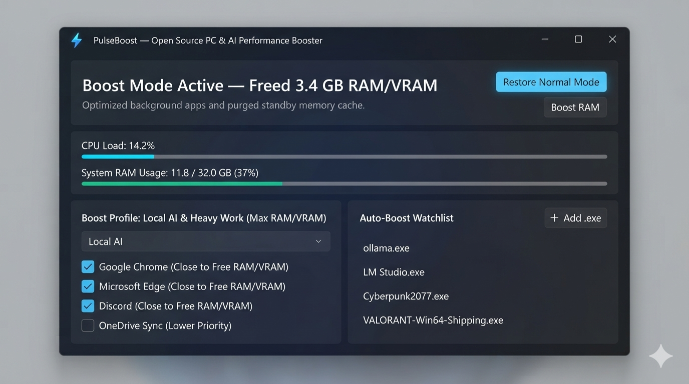

<div align="center">
  
  <h1>⚡ PulseBoost</h1>
  <p><strong>Open-Source PC Performance, Gaming & Local AI Booster for Windows 10/11</strong></p>
  <p><em>Reclaim RAM & VRAM, eliminate frame stutters, and boost local LLMs (Ollama, LM Studio) with one click — zero telemetry, zero registry gimmicks.</em></p>

  <p>
    <a href="https://github.com/vijayendrashrimant/PulseBoost/releases"></a>
    <a href="https://github.com/vijayendrashrimant/PulseBoost"></a>
    <a href="https://github.com/vijayendrashrimant/PulseBoost/blob/master/LICENSE"></a>
    
    
  </p>

  <p>
    <a href="#-download--install">Download</a> •
    <a href="#-why-pulseboost">Why PulseBoost?</a> •
    <a href="#-features">Features</a> •
    <a href="#-how-it-works-under-the-hood">How It Works</a> •
    <a href="#-build-from-source">Build from Source</a>
  </p>
</div>

---

<!-- Replace this path with an actual screenshot of your running app! -->
<div align="center">
  
</div>

---

## 🎯 Why PulseBoost?

Most "PC Boosters" are closed-source bloatware filled with ads, fake registry cleaners, and background trackers. Meanwhile, gamers and people running **local LLMs (Ollama, LM Studio, ComfyUI)** constantly fight background browsers, updaters, and Windows Standby RAM eating precious memory.

**PulseBoost solves this cleanly and transparently:**
- **Built for Everyday Humans & Power Users:** One big button—no confusing jargon or risky registry tweaks.
- **Built for Local AI & Gaming:** Frees system RAM and GPU VRAM before you load a multi-gigabyte `.gguf` model or launch a competitive game.
- **100% Reversible:** Automatically restores your Windows power plan and reopens any closed apps the moment you exit your game or AI session.

---

## ✨ Features

| Feature | What It Actually Does |
| :--- | :--- |
| **🎮 Gaming Mode Preset** | Switches Windows to **High Performance**, elevates game process priority, and lowers background sync priority to prevent FPS drops. |
| **🧠 Local AI & Heavy Work Mode** | Safely closes memory-hungry browsers/overlays (and reopens them afterward) to maximize RAM & VRAM headroom for **Ollama, LM Studio, Blender, and Premiere**. |
| **🚀 Deep RAM & Standby Cache Cleaner** | Uses native Windows APIs (`EmptyWorkingSet` & `MemoryPurgeStandbyList`) to trim idle process memory and purge cached Standby RAM on demand. |
| **🎚️ Auto-RAM Cleaner Threshold** | Automatically trims excess RAM whenever memory usage crosses your custom threshold (e.g., `80%`) during long gaming or LLM sessions. |
| **🤖 Zero-Touch Auto-Watchlist** | Sits quietly in the system tray (`< 15 MB` RAM) and activates Boost automatically when any watched `.exe` starts—restoring everything when it closes. |
| **🧹 Safe Disk & Cache Sweeper** | Scans and cleans genuine Windows Temp folders, DirectX shader caches, and browser caches without touching saved passwords or the Registry. |
| **🚦 Plain-English Startup Manager** | Toggle slow startup programs on or off cleanly without digging through Windows Task Manager. |

---

## 📥 Download & Install

No `.NET` runtime installation or command-line setup required:

1. Head over to the [**Releases**](https://github.com) page.
2. Download **`PulseBoost-Setup.exe`** (Windows Installer) or **`PulseBoost.exe`** (Portable Single-File).
3. Launch **PulseBoost** and click **Activate Boost** or **Boost RAM**.

---

## 🔬 How It Works (Under the Hood)

Transparency builds trust. Here is every Windows API PulseBoost uses—and nothing more:

1. **Power Plan Management (`powercfg.exe`):** Reads your active power scheme GUID, activates `High Performance` (`8c5e7fda-e8bf-4a96-9a85-a6e23a8c635c`), and restores your original scheme when deactivated.
2. **Standby Memory & Working Set Trimming (`psapi.dll` & `ntdll.dll`):** Calls `EmptyWorkingSet` on non-critical user processes and `NtSetSystemInformation(SystemMemoryListInformation)` to release cached Standby memory back to free RAM.
3. **WMI Process Event Tracing (`Win32_ProcessStartTrace`):** Listens passively for watched `.exe` launches with near-zero CPU overhead.
4. **Local-Only Configuration:** All preferences and watchlists are stored locally in `%AppData%\PulseBoost\settings.json`. Zero analytics, zero internet requests.

---

## 🛠️ Build from Source

### Prerequisites
- Windows 10 (1903+) or Windows 11
- [.NET 8.0 SDK](https://microsoft.com)
- Visual Studio 2022 (with the **.NET desktop development** workload)

### Quick Start
```bash
git clone https://github.com
cd PulseBoost
dotnet restore
dotnet run --project PulseBoost/PulseBoost.csproj
```

---

## 🗺️ Roadmap

- [x] One-Click Gaming & Local AI Boost Profiles
- [x] Native Working Set & Standby RAM Purger + Auto-Threshold
- [x] Automatic Process Launch Watcher & System Tray Mode
- [x] Safe Temp/Cache Sweeper & Startup Manager
- [ ] Live GPU VRAM & Temperature Telemetry (NVIDIA / AMD / Intel)
- [ ] Per-Game Custom Power & Process Profiles
- [ ] Winget Package Manager Submission (`winget install PulseBoost`)

---

## 🤝 Contributing

Contributions make open source awesome! Whether you want to improve Fluent UI animations, add safe cleanup paths, or localize the app into more languages:

1. **Fork** the repository
2. Create your feature branch (`git checkout -b feat/amazing-feature`)
3. Commit your changes (`git commit -m 'Add amazing feature'`)
4. **Push** to the branch (`git push origin feat/amazing-feature`)
5. Open a **Pull Request**

---

## ⭐ Support the Project

If **PulseBoost** helped free up RAM for your games or local AI models, please consider giving the repository a **Star ⭐**—it helps more Windows users discover safe, open-source tools!

---

## 📄 License

Distributed under the **MIT License**. See [`LICENSE`](LICENSE) for more details.
